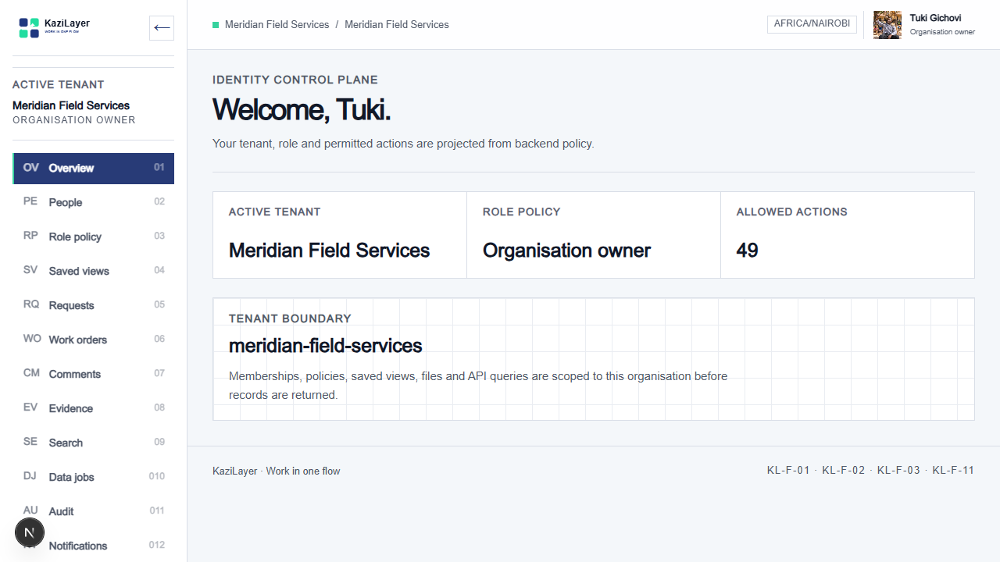
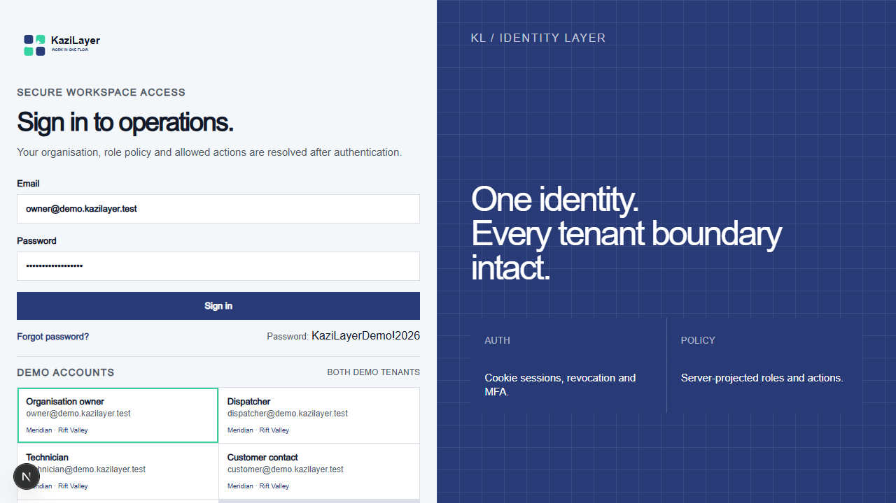
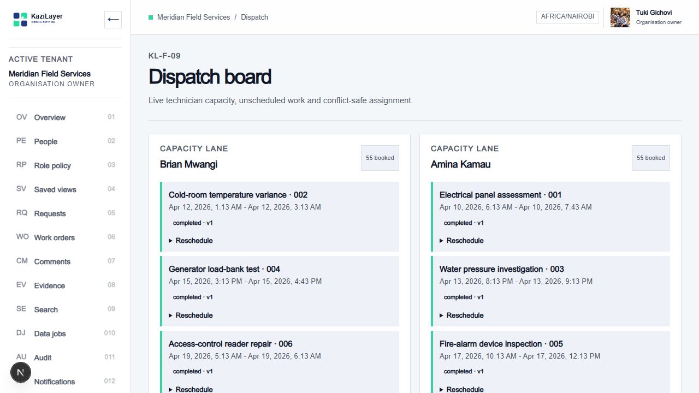
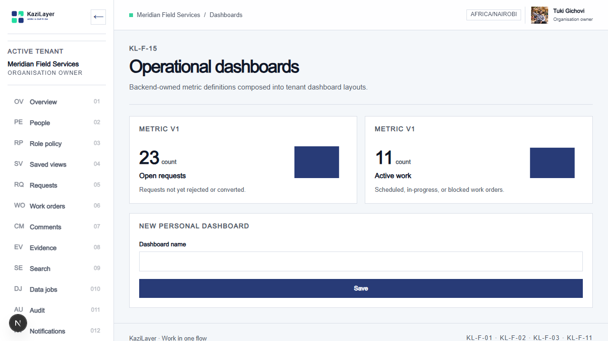
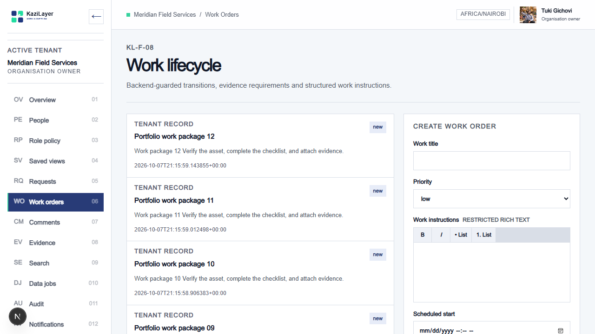

# KaziLayer

**Multi-tenant service operations, coordinated in one flow.**

KaziLayer brings request intake, dispatch, field work, evidence, SLA control, integrations and audit history into one tenant-safe workspace. Django owns domain truth and permissions; Next.js projects versioned contracts through a reusable Adaptive Convergence UI kernel.



## Product status

All 24 requirements in the KaziLayer feature specification have an implemented vertical slice. See the detailed [feature audit](docs/FEATURE_AUDIT.md).

- [x] KL-F-01 Tenant identity
- [x] KL-F-02 Authentication and sessions
- [x] KL-F-03 Role policy
- [x] KL-F-04 Contract registry
- [x] KL-F-05 Dynamic forms
- [x] KL-F-06 Adaptive record views
- [x] KL-F-07 Request intake
- [x] KL-F-08 Work lifecycle
- [x] KL-F-09 Dispatch board
- [x] KL-F-10 SLA engine
- [x] KL-F-11 Saved views
- [x] KL-F-12 Bulk operations
- [x] KL-F-13 Comments and mentions
- [x] KL-F-14 File evidence
- [x] KL-F-15 Operational dashboards
- [x] KL-F-16 Authorised search
- [x] KL-F-17 Notifications
- [x] KL-F-18 Realtime updates
- [x] KL-F-19 Imports and exports
- [x] KL-F-20 Audit ledger
- [x] KL-F-21 Integration webhooks
- [x] KL-F-22 User feedback
- [x] KL-F-23 Accessibility preferences
- [x] KL-F-24 Handover documentation

## Product tour

### Secure, tenant-aware sign-in

The login screen exposes the five demo roles and identifies their tenant access. Authentication resolves memberships and backend-owned actions before navigation is projected.



### Dispatch and scheduling

Dispatchers work from technician capacity lanes. Assignment and rescheduling writes lock and recheck the selected time window, reject overlaps and require an expected record version.



### Operational intelligence

Dashboard widgets consume backend-owned metric definitions, ensuring API, cards and charts reconcile to the same business calculation.



### Contract-aware field work

Work orders combine guarded lifecycle state, rich instructions, evidence requirements, SLA deadlines and assignment history.



## Architecture

```text
backend/   Django domain models, policies, APIs, migrations and seed commands
frontend/  Next.js routes, projection kernel, design system and interactive islands
contract/  Versioned generated contract artefacts
design/    Canonical design tokens and visual references
docs/      Architecture, API, runbook, audit and screenshots
```

Core operating rules:

- Backend policy and tenant filtering run before serialization.
- Rich text is sanitised server-side and stored with a plain-text projection.
- Shared UI resolves fields, recipes, slots and actions from contract metadata.
- Lists, streams, queries, selections and delivery logs are bounded.
- Concurrent schedules use transactions, overlap rechecks and record versions.
- Accessibility preferences affect presentation only, never business data.

## Local setup

### 1. Backend

```powershell
cd backend
uv sync --dev
.\.venv\Scripts\python.exe manage.py migrate
.\.venv\Scripts\python.exe manage.py seed_neon_demo
.\.venv\Scripts\python.exe manage.py runserver 8000
```

### 2. Frontend

```powershell
cd frontend
pnpm install
pnpm dev
```

Open [http://localhost:3000/login](http://localhost:3000/login). Next.js proxies `/api/*` to `http://127.0.0.1:8000` by default while preserving Django's trailing-slash routes.

## Demo tenants and accounts

Every identity belongs to both seeded tenants, with a tenant-specific membership and role policy:

- **Meridian Field Services** — `meridian-field-services`
- **Rift Valley Facilities** — `rift-valley-facilities`

| Role | Email | Password | Tenants |
| --- | --- | --- | --- |
| Organisation owner | `owner@demo.kazilayer.test` | `KaziLayerDemo!2026` | Meridian + Rift Valley |
| Dispatcher | `dispatcher@demo.kazilayer.test` | `KaziLayerDemo!2026` | Meridian + Rift Valley |
| Technician | `technician@demo.kazilayer.test` | `KaziLayerDemo!2026` | Meridian + Rift Valley |
| Customer contact | `customer@demo.kazilayer.test` | `KaziLayerDemo!2026` | Meridian + Rift Valley |
| Auditor | `auditor@demo.kazilayer.test` | `KaziLayerDemo!2026` | Meridian + Rift Valley |

These credentials are for local demonstrations only.

## Six-month demonstration dataset

`seed_neon_demo` is the canonical, idempotent seed for a fresh Neon PostgreSQL database. It calls all foundational seeds before building a 182-day operating history for each tenant.

Per tenant, the current dataset includes approximately:

| Data | Count | Simulation purpose |
| --- | ---: | --- |
| Requests and work orders | 117 each | Intake volume across 26 weeks |
| Technician assignments | 110 | Completed, active and scheduled capacity |
| Comments and audit events | 105 each | Collaboration and immutable traceability |
| Notifications | 108 | Read and outstanding operational events |
| Feedback records | 14 | Closed and reviewing product feedback |
| Realtime events | 106 | Ordered tenant stream history |
| Bulk operations | 7 | Monthly exports plus the base operation |
| SLA policies | 4 | Low, normal, high and critical targets |

To seed Neon after configuring the database connection:

```powershell
cd backend
.\.venv\Scripts\python.exe manage.py migrate
.\.venv\Scripts\python.exe manage.py seed_neon_demo
```

Running the seed again updates deterministic records instead of duplicating them.

## Feature URLs

Replace `{tenant}` with either seeded tenant slug.

| Workspace | URL |
| --- | --- |
| Overview | `/{tenant}` |
| Requests | `/{tenant}/requests` |
| Work lifecycle | `/{tenant}/work-orders` |
| Dispatch board | `/{tenant}/dispatch` |
| SLA policies | `/{tenant}/sla` |
| Dashboard | `/{tenant}/dashboards` |
| Contract registry | `/{tenant}/contracts` |
| Dynamic forms | `/{tenant}/dynamic-forms` |
| Realtime | `/{tenant}/realtime` |
| Integrations | `/{tenant}/integrations` |
| Audit ledger | `/{tenant}/audit` |
| Accessibility | `/{tenant}/accessibility` |
| Design system | `/design-system` |

## Simulated delivery timeline

- [x] **Week 1 — Foundation:** repository rules, stack bootstrap and design tokens
- [x] **Week 2 — Identity:** tenants, memberships, branding and media
- [x] **Week 3 — Security:** sessions, reset, revocation, MFA and profiles
- [x] **Week 4 — Policy:** role registry and backend action enforcement
- [x] **Week 5 — Personalisation:** saved views, settings and accessibility
- [x] **Week 6 — Convergence gate:** contract artefacts, seeds and responsive review
- [x] **Weeks 7–10 — Operations:** requests, work lifecycle, evidence and comments
- [x] **Weeks 11–14 — Control:** search, imports/exports, audit and notifications
- [x] **Weeks 15–18 — Adaptive UI:** contracts, forms, recipes and dashboards
- [x] **Weeks 19–22 — Integration:** webhooks, realtime and bounded bulk operations
- [x] **Weeks 23–26 — Advanced operations:** SLA engine, dispatch and handover

The timeline is a portfolio delivery simulation, not elapsed calendar time.

## Verification

```powershell
cd backend
.\.venv\Scripts\python.exe manage.py check
.\.venv\Scripts\python.exe manage.py makemigrations --check --dry-run
.\.venv\Scripts\python.exe -m ruff check .
.\.venv\Scripts\python.exe -m pytest

cd ..\frontend
pnpm lint
pnpm build
```

Supporting references: [API and data guide](docs/API_AND_DATA.md), [operations runbook](docs/RUNBOOK.md), [handover index](docs/HANDOVER.md), and [project context](docs/project-context.md).
